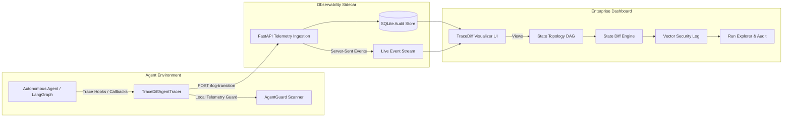

# TraceDiff: Enterprise Agentic Observability Sidecar

**TraceDiff** is an enterprise-grade observability sidecar and state diffing framework designed to monitor, audit, and visualize complex multi-agent workflows. It provides deep transparency into autonomous AI systems by tracking token consumption, computing deterministic state deltas, detecting cyclical loops, and streaming real-time security telemetry.

---

## Key Capabilities

- **Deterministic State Delta Diffing:** Automatically computes JSON & structural state mutations (additions, deletions, and value mutations) with Git-style red/green visual highlighting.
- **Complex Multi-Agent Topology & Loop Detection:** Generates dynamic Mermaid.js DAGs reflecting branching, parallel hops, failure states, and cyclic retry loops.
- **Token & Cost Observability:** Tracks prompt vs. completion token consumption per node with real-time model cost estimation (USD) across models (GPT-4o, Claude 3.5 Sonnet, Llama 3).
- **AgentGuard Real-Time Security Scanner:** In-flight telemetry engine detecting prompt injection, DAN jailbreaks, credential leaks (OpenAI, AWS, GitHub tokens), PII, and filesystem exfiltration.
- **Real-Time Live Streaming (SSE):** Server-Sent Events stream live graph updates as autonomous agents execute.
- **Run Explorer & Audit History:** Comprehensive persistence in SQLite with multi-run switching, audit status filters, and exportable telemetry.
- **Zero-Boilerplate Instrumentation:** Supports context managers (`with tracer.step(...)`), Python decorators (`@tracer.trace`), and native LangChain / LangGraph callback handlers (`TraceDiffLangGraphCallbackHandler`).

---

## System Architecture



---

## Quickstart

### 1. Installation

```bash
# Clone repository
git clone https://github.com/AK-1612/TraceDiff.git
cd TraceDiff

# Activate environment and install dependencies
python3 -m venv .venv
source .venv/bin/activate
pip install -r requirements.txt
```

### 2. Launch the Sidecar Server

```bash
uvicorn server:app --host 0.0.0.0 --port 8000 --reload
```

The enterprise dashboard is accessible at:
- **Trace Debugger:** `http://localhost:8000/debug`
- **Run Explorer:** `http://localhost:8000/runs`
- **Vector Scanning & Security:** `http://localhost:8000/vector-scanning`
- **System Settings:** `http://localhost:8000/settings`

### 3. Run Autonomous Multi-Agent Workflows

**Option A: Real-World Local LLM Workflow (Ollama / Llama 3)**
Executes a 5-node collaborative pipeline (Planner -> Research -> Security -> Synthesis -> Governance) querying local Ollama and tracking actual token consumption:
```bash
python ollama_agent_run.py "Analyze the architectural trade-offs between Microservices and Monoliths"
```

**Option B: Simulated Multi-Agent Self-Healing Workflow**
Simulates a branching multi-agent pipeline with credential exfiltration detection, AgentGuard intervention, and a self-healing retry loop:
```bash
python sample_graph_run.py
```

---

## Agent Instrumentation Example

### Using the Context Manager

```python
from tracer import TraceDiffAgentTracer

tracer = TraceDiffAgentTracer(run_id="run_101", default_model="gpt-4o", auto_security_scan=True)

state = {"query": "Analyze Q3 balance sheet", "phase": "init"}

# Step 1: Planner Node
with tracer.step("PlannerNode", state_before={}) as step:
    state["tasks"] = ["extract_revenue", "validate_tax"]
    state["phase"] = "planned"
    step.set_state_after(state)
    step.add_tool_call("task_planner", status="success", output="Tasks created")
    step.set_tokens(prompt=250, completion=80, model="gpt-4o")

# Step 2: Coder Node (Branching from Planner)
with tracer.step("ExecutionNode", parent_node="PlannerNode", state_before=state) as step:
    state["phase"] = "completed"
    state["revenue"] = 42000000
    step.set_state_after(state)
    step.set_tokens(prompt=400, completion=150, model="gpt-4o")
```

### Using LangGraph Callback Handler

```python
from tracer import TraceDiffAgentTracer, TraceDiffLangGraphCallbackHandler
from langgraph.graph import StateGraph

tracer = TraceDiffAgentTracer(run_id="langgraph_prod_01")
callback_handler = TraceDiffLangGraphCallbackHandler(tracer)

# Pass callback_handler into graph execution config
app.invoke({"messages": [...]}, config={"callbacks": [callback_handler]})
```

---

## Test Suite

Run the full automated test suite verifying database migrations, state diffing, security heuristics, and API endpoints:

```bash
python -m unittest test_tracediff_suite.py
```
